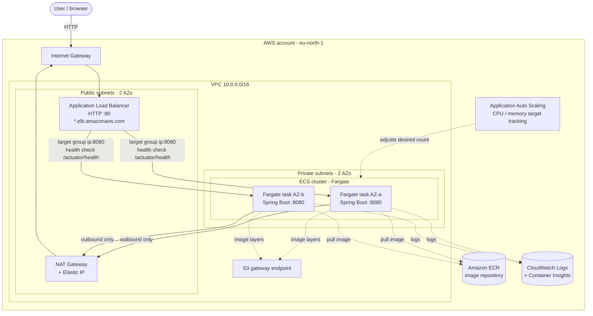
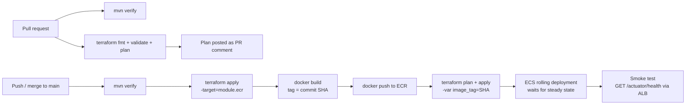

# Spring Boot on AWS ECS Fargate with Terraform

An end-to-end example that builds a Spring Boot application into a Docker image, pushes it to Amazon ECR, and runs it on **ECS Fargate** behind an **Application Load Balancer**, with all the infrastructure provisioned by **Terraform** and deployed by **GitHub Actions**. The app and infra live in the same repository.

- **Region:** `eu-north-1` (Stockholm)
- **Access:** the ALB's AWS-provided DNS name over HTTP (no custom domain or TLS certificate)
- **State:** remote, in your S3 bucket, with S3 native locking

---

## Table of contents

1. [Architecture](#architecture)
2. [Repository layout](#repository-layout)
3. [CI/CD pipeline](#cicd-pipeline)
4. [Setup (one time)](#setup-one-time)
5. [Deploying](#deploying)
6. [Configuration (variables)](#configuration-variables)
7. [Running locally](#running-locally)
8. [Operations](#operations)
9. [Tearing it down](#tearing-it-down)
10. [Cost notes](#cost-notes)
11. [Going further](#going-further)

---

## Architecture



### How a request flows

1. The user calls `http://<alb-dns-name>`.
2. The **ALB** sits in the public subnets and forwards the request to a healthy task registered in its target group. The target type is `ip`, which Fargate requires.
3. The **Fargate tasks** run in **private subnets**. They have no public IP, and their security group only accepts port 8080 from the ALB's security group, so the internet cannot reach them directly.
4. When a task needs to go outbound (pulling the image from ECR, shipping logs to CloudWatch, calling external APIs), the traffic leaves through the **NAT Gateway**.
5. A free **S3 gateway endpoint** carries ECR image-layer downloads (ECR stores layers in S3), so they skip the NAT's per-GB processing fee.

### AWS resources created

| Module | Resources |
|---|---|
| `network` | VPC, 2 public + 2 private subnets across 2 AZs, Internet Gateway, NAT Gateway + EIP, route tables, S3 gateway endpoint |
| `ecr` | ECR repository (scan on push, immutable tags), lifecycle policy that keeps the last 15 images |
| `alb` | Application Load Balancer, HTTP:80 listener, `ip` target group with health check, ALB security group |
| `ecs` | ECS cluster (Container Insights on, `FARGATE` and `FARGATE_SPOT` capacity providers), task definition, service, task execution role, task role, task security group, CloudWatch log group, autoscaling target + CPU/memory policies |

### Where Fargate comes in

Fargate isn't a resource of its own. It's the compute engine chosen on the ECS cluster, task definition and service (`infra/modules/ecs/main.tf`):

- the cluster enables the `FARGATE` and `FARGATE_SPOT` capacity providers;
- the task definition sets `requires_compatibilities = ["FARGATE"]` and `network_mode = "awsvpc"`, and its `cpu` and `memory` size each task;
- the service's `capacity_provider_strategy` uses `FARGATE`, or `FARGATE_SPOT` when `use_fargate_spot = true`.

There are no EC2 instances to manage or patch. AWS runs each task on isolated compute, and you pay per vCPU-second and GB-second while tasks run.

### Security choices

- Tasks have only private IPs and accept traffic only from the ALB.
- The container runs as a **non-root user** in a slim JRE image.
- Two IAM roles split the permissions:
  - The **execution role** is used by the ECS agent to pull the image and write logs.
  - The **task role** is used by the app and starts with no permissions except ECS Exec.
- ECR scans every pushed image for vulnerabilities, and tags are **immutable**, so a deployed version can't be overwritten.
- The ALB drops invalid HTTP header fields.

### Reliability choices

- The service runs 2 tasks in 2 AZs, and autoscaling moves between 2 and 4 tasks.
- Rolling deployments keep 100% of tasks healthy while running up to 200% during the rollout, so there's no downtime.
- The **deployment circuit breaker with automatic rollback** returns the service to the previous task definition if new tasks never become healthy.
- `wait_for_steady_state = true` makes `terraform apply`, and so the pipeline, fail when a deployment doesn't stabilise.
- Health checks run at two levels: the ALB checks `/actuator/health`, and the container has its own health check.
- Spring Boot uses graceful shutdown, and the ALB's 30-second deregistration delay lets in-flight requests finish when a task stops.

---

## Repository layout

```
.
├── app/                                  Spring Boot application
│   ├── Dockerfile                        multi-stage: Maven build → JRE 21 alpine, non-root
│   ├── pom.xml                           Spring Boot 4, Java 21, web + actuator
│   └── src/
│       ├── main/java/com/example/demo/   DemoApplication, HelloController
│       ├── main/resources/application.yml
│       └── test/java/...                 tests
├── infra/                                Terraform root module
│   ├── backend.tf                        S3 backend (bucket/region passed at init)
│   ├── versions.tf                       Terraform >= 1.10, AWS provider ~> 6.0
│   ├── providers.tf                      AWS provider + default tags
│   ├── main.tf                           wires the modules together
│   ├── variables.tf                      every tunable, with defaults + validation
│   ├── outputs.tf                        alb_url, ECR URL, cluster/service names...
│   ├── envs/dev.tfvars                   values for the dev environment
│   └── modules/
│       ├── network/                      VPC, subnets, IGW, NAT, routes, S3 endpoint
│       ├── ecr/                          image repository + lifecycle policy
│       ├── alb/                          load balancer, listener, target group, SG
│       └── ecs/                          cluster, task def, service, IAM, logs, autoscaling
└── .github/workflows/
    ├── deploy.yml                        push to main → test, build, push, apply, smoke test
    ├── terraform-plan.yml                pull request → test, fmt, validate, plan (as PR comment)
    └── destroy.yml                       manual → terraform destroy (requires typing "destroy")
```

### Application endpoints

| Path | Description |
|---|---|
| `/` | Welcome message |
| `/api/hello?name=you` | Greeting |
| `/api/info` | Version (image tag), environment, **hostname of the task**. Refresh a few times to see the ALB alternate between tasks |
| `/actuator/health` | Health endpoint used by the ALB and the container health check |

---

## CI/CD pipeline



### `deploy.yml`: push to `main` (or run manually)

| Step | What happens | Why |
|---|---|---|
| **Test** | `mvn -B verify` on Java 21 | Don't ship a broken build |
| **Terraform init** | Connects to the S3 backend with `-backend-config` for bucket and region | The state bucket name stays out of the code |
| **Apply ECR only** | `terraform apply -target=module.ecr` | Solves the chicken-and-egg problem: the image must be pushed to a repository that Terraform creates. On the first run this creates the repository; after that it changes nothing |
| **Check image** | `aws ecr describe-images` for the commit SHA | Tags are immutable, so re-running a job skips a rebuild instead of failing |
| **Build & push** | Docker Buildx builds `app/Dockerfile` for `linux/amd64`, tags it `<ecr-url>:<git-sha>` and pushes it, with GitHub Actions layer caching | Every deployment traces back to an exact commit |
| **Plan + apply** | `terraform plan -var image_tag=<sha> -out=tfplan`, then `apply tfplan` | Creates or updates the VPC, ALB and ECS. The new tag produces a new task definition revision, which triggers a rolling deployment. Terraform waits until the service is stable |
| **Smoke test** | Polls `http://<alb>/actuator/health` until it returns `UP`, then prints `/api/info` | Proves the app is reachable through the public ALB |
| **Summary** | Writes the image tag, cluster, service and URL to the job summary | You get the app's URL straight from the run page |

Terraform owns the image tag, so the state always matches what's actually running, and you can roll back by re-running the deploy workflow on an older commit.

`concurrency: deploy-dev` ensures two deployments, or a deployment and a destroy, never run at the same time. The S3 lockfile also protects the state itself.

### `terraform-plan.yml`: pull requests

The workflow runs the tests, then `terraform fmt -check`, `validate` and `plan`, and posts the plan as a collapsible PR comment so reviewers see exactly which infrastructure will change. It doesn't build or deploy anything.

### `destroy.yml`: manual

Run it from the Actions tab, type `destroy`, and it runs `terraform destroy`. This removes everything, including the ECR repository and its images (`ecr_force_delete = true`). Your state bucket is never touched.

---

## Setup (one time)

### Prerequisites

- An AWS account and an **existing S3 bucket** for Terraform state, ideally with versioning enabled and public access blocked.
- An **IAM user** with an access key for the pipeline (see the permissions below).

### 1. IAM permissions for the pipeline user

The simplest option for a sandbox account is to attach `AdministratorAccess`. To scope it down, the pipeline needs to manage these services:

- `ec2:*` for the VPC, subnets, NAT, EIP, security groups and endpoints
- `elasticloadbalancing:*`
- `ecs:*`
- `ecr:*`
- `logs:*`
- `application-autoscaling:*`, plus `cloudwatch:PutMetricAlarm`, `cloudwatch:DeleteAlarms` and `cloudwatch:DescribeAlarms` (target tracking creates alarms)
- `iam:CreateRole`, `DeleteRole`, `GetRole`, `PassRole`, `AttachRolePolicy`, `DetachRolePolicy`, `PutRolePolicy`, `DeleteRolePolicy`, `GetRolePolicy`, `ListRolePolicies`, `ListAttachedRolePolicies`, `ListInstanceProfilesForRole`, `TagRole` and `CreateServiceLinkedRole`
- `s3:ListBucket`, `GetObject`, `PutObject` and `DeleteObject` on the state bucket (`DeleteObject` is needed for the lock file)
- `sts:GetCallerIdentity`

### 2. GitHub repository secrets and variables

In **Settings → Secrets and variables → Actions**:

| Type | Name | Value |
|---|---|---|
| Secret | `AWS_ACCESS_KEY_ID` | access key of the pipeline user |
| Secret | `AWS_SECRET_ACCESS_KEY` | secret key of the pipeline user |
| Variable | `TF_STATE_BUCKET` | name of your state bucket |
| Variable | `AWS_REGION` | `eu-north-1` (the default if unset) |

Never commit credentials. They only live in GitHub secrets.

### 3. GitHub environment (optional but recommended)

The deploy and destroy jobs use the `dev` environment. GitHub creates it automatically on the first run. To require a manual approval before each deployment, open **Settings → Environments → dev** and add *Required reviewers*.

---

## Deploying

1. Push to `main`, or open **Actions → Deploy → Run workflow**.
2. The first run creates the whole stack. Most of the time goes into creating the NAT Gateway and ALB and waiting for the first tasks to become healthy.
3. Open the run's **summary** and click the URL, which looks like
   `http://springboot-ecs-dev-alb-123456789.eu-north-1.elb.amazonaws.com`.

```bash
curl http://<alb-dns-name>/api/info
# {"version":"3f9c2e1...","environment":"dev","hostname":"ip-10-0-10-23...","javaVersion":"21...","timestamp":"..."}
```

To change the app, edit code under `app/`, open a PR, review the plan comment, and merge. The pipeline builds a new image and ECS rolls it out with no downtime.

### Running Terraform from your machine

```bash
cd infra
terraform init \
  -backend-config="bucket=<your-state-bucket>" \
  -backend-config="region=eu-north-1"

terraform plan  -var-file=envs/dev.tfvars -var="image_tag=<an-existing-tag>"
terraform apply -var-file=envs/dev.tfvars -var="image_tag=<an-existing-tag>"
```

Use a tag that already exists in ECR, such as the last deployed commit SHA (`terraform output deployed_image_tag`). Otherwise the new tasks can't pull their image and the circuit breaker rolls the deployment back.

---

## Configuration (variables)

All settings live in `infra/variables.tf`, with defaults and validation, and are overridden per environment in `infra/envs/dev.tfvars`.

| Variable | Default | Description |
|---|---|---|
| `aws_region` | `eu-north-1` | Region |
| `project_name` | `springboot-ecs` | Prefix for every resource name |
| `environment` | `dev` | Environment name, used in names and tags |
| `vpc_cidr` | `10.0.0.0/16` | VPC CIDR. Public subnets use `.0.x`/`.1.x`, private subnets `.10.x`/`.11.x` |
| `az_count` | `2` | Number of AZs, 2 or 3 |
| `nat_gateway_mode` | `single` | `single` = one NAT, `per_az` = one per AZ (HA), `none` = tasks in public subnets with public IPs, no NAT |
| `alb_allowed_cidrs` | `["0.0.0.0/0"]` | Who may reach the ALB |
| `image_tag` | *(set by pipeline)* | Image tag to run |
| `ecr_image_tag_mutability` | `IMMUTABLE` | ECR tag mutability |
| `ecr_max_image_count` | `15` | Images kept in ECR |
| `ecr_force_delete` | `true` | Allow destroy to delete a repository that still holds images |
| `container_port` | `8080` | App port |
| `health_check_path` | `/actuator/health` | ALB and container health check path |
| `task_cpu` / `task_memory` | `512` / `1024` | Fargate task size: 0.5 vCPU / 1 GB |
| `cpu_architecture` | `X86_64` | `ARM64` for Graviton. Also set `IMAGE_PLATFORM: linux/arm64` in `deploy.yml` |
| `use_fargate_spot` | `false` | Use Fargate Spot (cheaper, can be interrupted) |
| `desired_count` / `min_capacity` / `max_capacity` | `2` / `2` / `4` | Scaling bounds |
| `autoscaling_cpu_target` / `autoscaling_memory_target` | `60` / `75` | Target tracking percentages |
| `log_retention_days` | `14` | CloudWatch log retention |
| `enable_container_insights` | `true` | ECS Container Insights |
| `enable_execute_command` | `true` | Allow `aws ecs execute-command` |
| `extra_tags` | `{}` | Extra tags on every resource |

---

## Running locally

```bash
cd app
mvn spring-boot:run
curl localhost:8080/api/info

# or with Docker
docker build -t springboot-ecs app
docker run --rm -p 8080:8080 springboot-ecs
```

---

## Operations

```bash
# Tail application logs
aws logs tail /ecs/springboot-ecs-dev --follow --region eu-north-1

# Service status and recent events
aws ecs describe-services --cluster springboot-ecs-dev-cluster \
  --services springboot-ecs-dev-service --region eu-north-1 \
  --query 'services[0].{running:runningCount,desired:desiredCount,events:events[:5].message}'

# Open a shell in a running task (requires the Session Manager plugin locally)
TASK=$(aws ecs list-tasks --cluster springboot-ecs-dev-cluster \
  --service-name springboot-ecs-dev-service --query 'taskArns[0]' --output text --region eu-north-1)
aws ecs execute-command --cluster springboot-ecs-dev-cluster --task "$TASK" \
  --container springboot-ecs-dev --interactive --command "/bin/sh" --region eu-north-1
```

**Rolling back:** re-run the Deploy workflow on an earlier commit (Actions → the older run → *Re-run all jobs*). Its image is still in ECR, so the build is skipped and only the task definition changes.

---

## Tearing it down

**Actions → Destroy infrastructure → Run workflow**, then type `destroy`.

Do this when you're not using the environment: the **NAT Gateway and the ALB are billed every hour even with zero traffic**.

---

## Cost notes

The main costs for this setup:

| Component | Billing |
|---|---|
| NAT Gateway | Per hour + per GB processed (the biggest fixed cost here) |
| Application Load Balancer | Per hour + load balancer capacity units |
| Fargate | Per vCPU-hour and GB-hour for each running task (2 × 0.5 vCPU / 1 GB) |
| Public IPv4 addresses | Per hour, for the NAT Elastic IP and the ALB's IPs |
| CloudWatch, Container Insights, ECR storage | Small, usage-based |

Use the [AWS Pricing Calculator](https://calculator.aws/) for current `eu-north-1` prices. To spend less on dev:

- Set `use_fargate_spot = true`.
- Set `cpu_architecture = "ARM64"`.
- Set `min_capacity = 1`.
- Destroy the stack when you're not using it.

`nat_gateway_mode = "none"` removes the NAT cost entirely, but runs the tasks in public subnets.

---

## Going further

- **HTTPS:** add an ACM certificate and a 443 listener when you have a domain.
- **OIDC:** replace the static access keys with GitHub OIDC and an IAM role, so there are no long-lived credentials.
- **More environments:** add `envs/prod.tfvars` with its own state key (`-backend-config="key=.../prod/terraform.tfstate"`).
- **More VPC endpoints:** interface endpoints for ECR API/DKR and CloudWatch Logs pay off at higher traffic.
- **Secrets:** use AWS Secrets Manager or SSM Parameter Store, referenced from the task definition's `secrets` field.
